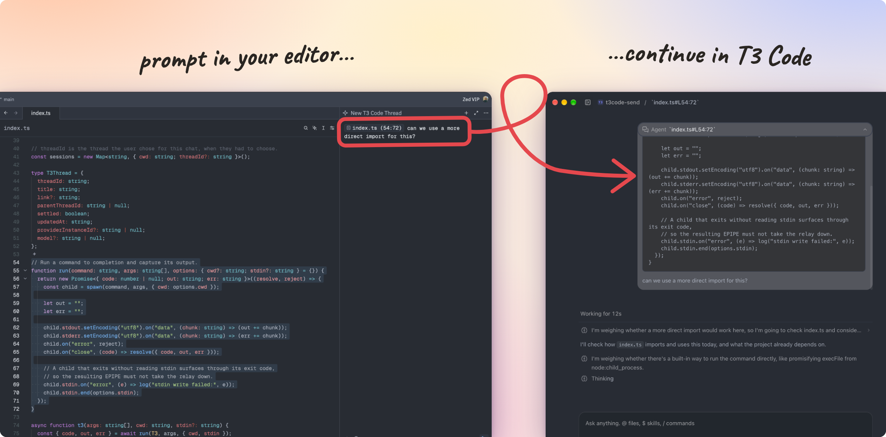

# T3 Code Send

Hand off messages from an editor with ACP support, like [Zed](https://zed.dev/), to a [T3 Code](https://t3.codes/) thread.



> Note: This is not designed to implement the full Agent Client Protocol. T3 Code responses will not be returned to the client, as the intent is to continue the conversation within T3 Code.


## Setup

Run it from npm with `npx`. Here's an example setup for Zed's `settings.json`:

```json
"agent_servers": {
  "T3 Code": {
    "type": "custom",
    "command": "npx",
    "args": ["-y", "t3code-send"]
  }
}
```

### Options

| Option | Description |
| --- | --- |
| `--t3-bin <path>` | Use a specific `t3` CLI. |
| `--no-focus` | Don't bring T3 Code into focus on the target thread when sending a message. |
